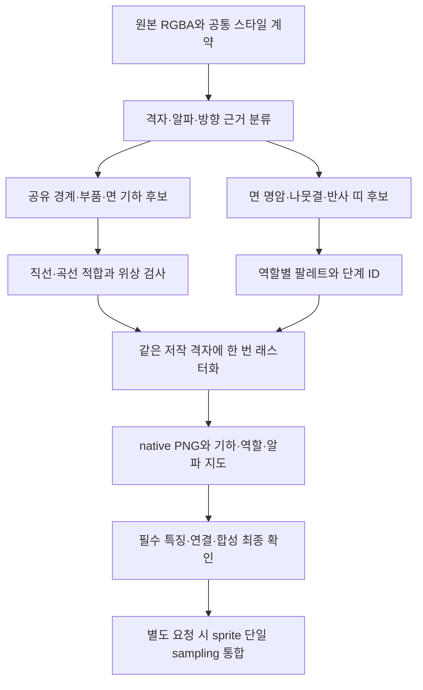

# 생성 원화의 픽셀 재작성 — 설계·미해결 연구

## 현재 연구 결정 — R12 (2026-10-04, 문서·입력 분석만)

사용자 요청은 현재 해결되지 않는 문제와 해결 가능한 기술을 조사·정리하는
것이다. 아래 R12가 최신 문제/후보/다음 판별 실험이다. R10과 [L11](LEGACY11.md)은
현재 구현의 증거이며, 연구 후보를 이미 구현된 기능으로 바꾸지 않는다.
이번에는 원본·변환 PNG·웹 기본 엔진·Unity 자산을 변경하지 않았다.

핵심 판단: RGB 팔레트 축소만으로는 불규칙 선, 반투명 합성색, 나뭇결의
정보 소실을 함께 해결하지 못한다. 확정 기하의 정수 재작도는 표준 기술로
가능하다. 원화에서 그 기하/재질/빛의 의미를 선택하는 단계는 별도 문제다.
우선 후보는 **구조선·면·디테일의 분리 표현 → 기하 적합 → 영역별 명암/무늬
단계 → 공통 격자의 단일 래스터화**다. 성공 여부는 아직 실험하지 않았다.

## R10 구현 당시 결정 (2026-10-03)

요구는 생성 원화의 디자인을 유지하며 지저분한 경계·연속 색을 실제 정수
픽셀과 단계 명암으로 재작성하는 로컬 실행 경로다. 임의의 64×64 축소,
재확대, 축별 늘림, 카메라 변경으로 대체하지 않는다. 기존 lossless,
bounded cleanup, V9 캐비닛·Unity 상태는 보존한다.

R0 직접 원인: cleanup은 ΔE 상한 밖의 원본색으로 돌아가므로 팔레트 상한이
없다. legacy `region_tones + line_normalization`은 미검증 조합으로 차단돼
있다. Uniform04는 전체64색·원본 해상도 시험이고 영역별4톤 통합은 아니다.

### 후보와 선택

| 후보 | 입력→출력, 근거 | 결정·반례 |
|---|---|---|
| upstream 격자 추정→색 샘플링 | 이미 존재하는 격자 후보를 추정 | 연속 원화에 원래의 격자가 있다는 증명 없음. 색/선 재작성은 하지 못함 |
| Pixelated Image Abstraction | SLIC 기반 공간·색 공동 최적화→작은 팔레트 그림 | 특징 보존 목적 참고. 작은 출력 크기를 먼저 정하는 그대로의 구현은 이번 요구와 다름 |
| 선 후보→재질 후보→단계 색→공통 격자 재래스터화 | 아래 R10 수학 계약 | 격리된 prototype으로 채택. 의미 추정과 정확한 격자 계산을 구분 |
| 알려진 모델·분리 패스→픽셀 | V9처럼 형상·법선·재료가 있는 입력 | 정확한 기하/재조명 가능. 임의 원화의 숨은 형상을 복원한 것으로 대체하지 않음 |

R10은 논문 전체의 복제나 의미 해석의 완벽성 증명이 아니다. 추론한
재질/선 후보는 가설이고 격자·색 선택·렌더는 결정적 계산이다.

## 수학과 공간 계약

입력 `I[y,x]`: RGB/RGBA uint8, 원본 좌표 x→오른쪽, y→아래, 좌상단 원점,
texel 중심 `(x+.5,y+.5)`, 최대4MP. 원본 파일 바이트를 별도 보존한다.
정규 표현은 `material_id`, `tone_id`, `line_mask`, `alpha`, 팔레트다.
리깅/본/숨은 면은 적용 대상이 아니다.

1. **입력 분석**: 이미 동일 RGBA 블록의 격자가 증명되면 기존 무손실
   규격 복원을 먼저 쓴다. 그 외에 원래 grid를 복구했다고 주장하지 않는다.
   이번 R10은 정확 반복의 증거가 없으면 source1px에서 재작성한다.
   불규칙 원화의 추정 pitch→재래스터화는 다음 연구 단계이고 구현하지
   않았다. 수동 W×H를 받지 않으며 source grid 결과를 별도 보존한다.
2. **선과 영역**: 어두운 ridge를 구조선 *후보*로 구하고 좁은 폭의 중심을
   Zhang–Suen thinning으로 구한다. 밝은 ridge는 선으로 덮지 않는다.
   어두운 금속 반사대와 진짜 홈은 단일 RGB로 유일하게 분류할 수 없으므로
   해당 후보를 semantic truth로 기록하지 않는다. 최종 구현은 양측 재질
   후보 일치·색도차≤8·양측 색도≥8을 추가하고, 중성 반사대가 의심되는
   후보는 승격하지 않는다. 유색 금속도 완전히 판별한다는 보장은 없다.
   밝기 띠는 ramp에 남기며 line mask와 명암 지도를 별도로 출력한다.
3. **색**: CIELAB 색도에 따른 재질 후보 `m`을 결정적으로 군집화한다.
   재질마다 명도 축을 3 또는4단계로 나누고 실제 원본 RGB의 대표값을
   `P[m,k]`로 선택한다. 최종 색 `C=P[m,k]`; bounded cleanup의 원본색
   fallback, 디더링, RGB 혼합은 없다. 저대비 후보와 동색 재질은 의미가
   확정된 분할이 아니며 confidence/오차를 기록한다.
4. **격자 출력**: `source=(p*(u+.5),p*(v+.5))`, 축마다 같은 전역 p와 원점.
   region/tone 소유권을 같은 셀에 대응시키고 contour는 정수 선마스크로
   다시 그린다. 이번 R10은 vector polyline fit이나 Bresenham 재투영까지
   구현한 것이 아니다. RGBA 이미지를 resize해서 색/선/alpha를 섞지 않는다.
   원화에 없는 slope를 강제로 넣거나 부위별 offset/scale을 더하지 않는다.
   구현된 pitch>1 경로는 정확 반복 입력의 격자 복원 뒤 재작성이고,
   후속 색/alpha 변경까지 무손실이라는 뜻은 아니다. 향후 **추정 격자
   재작화** 후보는 작은 특징·연결성·곡선의 명암 띠가 손실되면 채택하지
   않아야 한다. 현재 입증된 pitch가 없으면 source1px 결과를 제출하되
   공통 logical grid 정규화 성공이라고 표시하지 않는다.
5. **투명도**: 선택된 alpha128 coverage는 antialias를 제거하는 유손실
   규칙이다. 투명도 변경/소실 수와 silhouette 연결 성분을 기록한다.
   원본 alpha를 그대로 보존했다고 주장하지 않는다. RGB 입력의 배경을
   자동 투명화하지 않는다.
6. **표시**: native PNG와 정수 repeat 비교 그림을 별도 저장한다. 비교판을
   native/Unity 입력으로 사용하지 않는다. 원본→native 변환은1회뿐이다.

각 후보는 원본 폭·높이, 양 축 pitch, 중심과 셀 경계, area/crop 정책,
내부 대표색 수와 실제 최종색 수를 기록한다. source→native는 전역 uniform
scale이며 비선형 warp 없음. 셀 round-off가 최대 p/2라는 사실은 특징
보존 증명이 아니므로 별도 가는 부위/연결성과 재료 대비 관측이 필요하다.

## 분리된 조명 계약

`I=R⊙S`에서 양수 g에 대한 `R'=R⊙g, S'=S/g`도 같은 I다. 원화 한 장의
어두운 나뭇결과 실제 그림자는 단일하게 분리할 수 없다. 금속은 specular
항까지 있어 normal/roughness/view/light가 필요하다.

현재 prototype은 **원화의 명암을 스타일 단계로 보존**한다. `tone_id`는
albedo나 법선이 아니며 baked lighting을 제거했다고 기록하지 않는다.
게임 조명을 받을 때는 별도 light band `b`로 ramp의 단계만 이동하고,
색 광원도 유한 LUT에서 최종색을 선택하는 계약을 사용한다. 단순 RGB 곱셈은
팔레트색 수를 다시 늘린다. 이 도구의 조명 미리보기는 band 이동 실험이며
Unity 통합이나 방향성 재조명 완료가 아니다.

물리적 재조명은 동일 형상/카메라의 albedo, normal, depth, material,
AO, shadow, specular 분리 입력이 있어야 정확해진다. 모델 추정맵만으로
단일 이미지의 진짜 물리 재료를 복구했다고 판정하지 않는다.

고정 camera30° 계약은 변경하지 않는다. 이미지 평면90° 회전은 정수치환이
가능하지만 쿼터뷰 물체의 월드 yaw 회전과 다르다. 다른 면이 보이는 회전은
방향별 원화나 알려진 기하를 같은 카메라로 재투영해야 한다.

## 판별 실험·실패 기준 (실행 전 고정)

- 동일 격자 fixture: 이미 정규 픽셀인 input의 위치/실루엣을 불필요하게
  재생성하지 않는다. 실제 반복 증거와 grid1 해석을 구분한다.
- 얇은 손잡이/곡선 금속 fixture: 연결선1px, 내부 단조 명암4단계가 서로
  다른 마스크에 남는지 검사. 밝은 띠를 검은 선으로 만들면 실패다.
- 실제 원화: 이전 사용자 입력1489×1056 sprite sheet1회. 원본 SHA,
  라인/영역/단계 지도, native/정수 비교판, source/output 색 수, alpha
  변화, 후보 grid 탈락 이유, 단계별 시간을 남긴다.
- 색 수 상한/정수 격자/정렬만으로 디자인 합격이나100% 자동 복원을
  선언하지 않는다. 실제 결과를 함께 제출한다.
- 실패한 grid 후보는 source1px 결과로 조용히 성공 처리하지 않고,
  report의 `grid_status`에 미해결을 명시한다. 색·선 재작성 단계와 전체
  정규화의 기술 판정을 분리한다.

## 1차 연구 자료

- [Gerstner et al. Pixelated Image Abstraction (2012)](https://gfx.cs.princeton.edu/gfx/pubs/Gerstner_2012_PIA/Gerstner_2012_PIA_full.pdf): modified SLIC와 팔레트 공동 최적화. 원화의 semantic 복원 보장은 아님.
- [Kopf/Lischinski Depixelizing Pixel Art (2011)](https://johanneskopf.de/publications/pixelart/): 작은 기존 픽셀→벡터. 이번 입력과 방향은 다르며 연결성 보존 관점을 참조.
- [Kang et al. Flow-Based Image Abstraction (2009)](https://www.umsl.edu/~kangh/Papers/kang_tvcg09.pdf): ETF/FDoG 경계 방향. 모든 response가 구조선은 아님.
- [Winnemöller et al. XDoG (2012)](https://research.adobe.com/publication/xdog-an-extended-difference-of-gaussians-compendium-including-advanced-image-stylization/): 다중 scale 선 후보. 금속 highlight의 의미 판정은 아님.
- [EPFL SLIC/SLICO](https://www.epfl.ch/labs/ivrl/research/slic-superpixels/): 지역 군집화와 semantic material 분할의 차이.
- [MIT Revisiting Intrinsic Images](https://rin.csail.mit.edu/): 단일 RGB의 albedo/shading 비유일성과 사전조건.
- [Woodham photometric stereo](https://www.cs.ubc.ca/~woodham/papers/Woodham80c.pdf): 동일 표면·알려진 독립 광원·반사 조건이라는 추가 입력.
- [Unity Secondary Textures](https://docs.unity3d.com/kr/current/Manual/urp/SecondaryTextures.html), [2D Light properties](https://docs.unity3d.com/kr/6000.0/Manual/urp/2DLightProperties.html): normal/mask 지원은 이미 baked된 빛 제거 기능이 아님.

## 실제 결과·재개

`docs/artifacts/building37/Redraw10/`에서 실제 실행했다. WorkLoop의
prepare→render→validate 3단계가 완료됐으며 실제 시트 기술 검사21개가
통과했다. 원본1489×1056 그대로, visible RGB154,249→48. 분석0.104초,
재작성2.393초(색0.861초+선1.499초 포함); 이 수치는 파일 저장·검사·
WorkLoop 시작을 포함한 전체 시간과 다르다. 원본파일과 숨은 RGB는 보존했다.
alpha128 규칙으로 반투명578,487px가 바뀌고 nonzero alpha73,742px는
제거됐다. threshold128 기준 silhouette 연결 성분19개는 같다.

후보48,892px 중15,560px만 선 처리 후보로 채택했고33,332px는 보존했다.
가늘게 고정된 선11,082px, 주변영역 재배정4,478px, 미해결halo0px다.
재질색으로부터 후보를 고르는 것이며 semantic 선/재질 인식 완료는 아니다.

독립 곡면 금속/2px 손잡이 fixture, 어두운 중성 금속 반사대 fixture,
native 무변경, 반복3px/잘린 가장자리, 3단계 RGB 입력, 잘못된 단계 거부를
각각 확인했다. V4 HTTP 경로에서도 어두운 금속 fixture를 처리·검사·
다운로드했다(0.224초; 작은192×128입력, 전체 시트 속도와 다름).
`web-test.json`, `fixture-validation.json`에 직접 결과를 보존했다.

**전체 원래 격자 정규화는 미해결이다.** 이 실제 시트에는 정확 반복의
증거가 없어 `uncertified_source_lattice`이며1px 좌표에서 다시 그렸다.
48색이라고 native logical pixel 크기와 긴 대각선 리듬까지 복구한 것은
아니다. 원본에 존재하는 빨강/파랑 테두리와 카메라 오차도 자동으로 의미
판별해 제거·보정하지 않았다. 새 결과는 색·선·명암 재작성 prototype이고
사용자 미술 승인이나 Unity 통합 결과가 아니다. V9 current.json은 유지한다.

다음의 원인별 재개는 (a) 원화에 logical grid를 확정할 증거/저작 가이드가
있으면 공통격자에 region/contour를 재래스터화, (b) 잘못 승격된 유색 금속
ridge가 관측되면 그 후보의 분류만 수정, (c) 물리 조명이 필요하면 동일한
기하의 albedo/normal/depth 패스를 입력으로 추가하는 것이다. 상위 원화에
없는 정보는 임의의 축소·회전·색 재생성으로 만들어 완료 처리하지 않는다.

실행: `redraw_cli.py --source <PNG> --output <새 workspace 폴더> --levels 4`.
웹: `Start_Uniform_Web.cmd` 또는 http://127.0.0.1:8768/ → 선·영역 재작성.
작업 단위의 결정적 계산에는 모델/API 호출이 없다.

## R12 — 미해결 문제와 해결 후보

### 1. 현재 증거와 범위

실제 입력은 1489×1056 RGBA 시트, 원본 SHA
`e4eb81a6bb53708a807e7eb182bfaa10bc39e37a5ed337c7913384323172d1ae`다.
[R10 기록](../../docs/artifacts/building37/Redraw10/analysis.json)은
`uncertified_source_lattice`, 출력1px, visible RGB154,249→48색이며
alpha128로 반투명578,487px를 변경했다. 이는 실제 저작 격자 복구가 아니다.
[L11 기록](../../docs/artifacts/building37/Legacy11/validation.json)은
원본 해상도/알파를 유지한 옛 색상 범위별3/4단계 결과74/98색이다.
비교에서 약한 나뭇결이 단색으로 합쳐지고 경계 잔색이 남았다.

**추가 입력 분석:** L11 4단계 PNG에는 visible RGB98개와 달리
visible RGBA5,756조합, visible alpha255단계, 반투명578,487px가 있다.
sRGB를 선형 색으로 변환해 완전 불투명 검정/흰 배경에 합성한 뒤8bit로
반올림하면 visible RGB가 각각2,789/3,665개다. 이것은 명시한 색 공간·배경의
CPU 합성 계산이며 실제 Unity 캡처가 아니다. RGB 팔레트만 검사하면 합성 후
중간색을 놓칠 수 있다는 증거다. [진단 JSON](../../docs/artifacts/building37/Research12/alpha-observation.json)과
[읽기 전용 재계산 코드](../../docs/artifacts/building37/Research12/alpha_observation.py)를 보존한다.

### 2. 문제별 원인·해결 범위

| ID | 현재 남은 문제와 원인 단계 | 해결 가능한 방법 | 필요한 입력·실패 조건·현재 상태 |
|---|---|---|---|
| P1 | 원래 logical pixel 크기 미확정. 정확 RGBA 반복 검출은 약한 색/알파 변화까지 검사하므로 GCD1로 탈락한다 | 진짜 반복 입력은 기존 무손실 경로 재사용. 불규칙 입력은 주기/계단 리듬 후보를 따로 추정하고 기하·특징 오차로 비교; 근거가 없으면 새 저작 격자로 재작도 | 검출 실패는 “PNG가 픽셀 데이터가 아니다”라는 뜻이 아니다. 여러 격자가 같은 그림을 설명하면 원래 규격 복구는 미정. 원본1px 출력이나 임의64×64를 복구 성공으로 삼지 않음 |
| P2 | 선이 여러 줄/불규칙 계단으로 남는다. R10 thinning은 후보를 가늘게 하지만 위치·방향·곡률을 적합하지 않는다 | 직선 후보 Hough→선정 점 robust `fitLine`; 곡면은 contour/Bezier; 공유 모서리·교점 한 번 적합→정수 `LINE_8` 재작도 | 선의 점집합/역할이 필요. 반사 띠를 구조선으로 오인하거나 평행선 합침, 손잡이 끊김, 구멍 소실이면 실패. 현재 기하 적합 미구현 |
| P3 | 나뭇결·세부가 단색으로 소실. 색상/색도 군집이 면·무늬·잡음을 구분하지 않는다 | ETF/FDoG/FBL로 방향성 디테일 후보 분석; 면의 명암과 나뭇결 지도를 따로 유지→같은 목재 ramp의3~4단계 ID에 반영 | 방향성 잡음과 나뭇결의 완전 의미 구분 보장 없음. 나뭇결을 검은 선으로 덮거나 두꺼운 몇 줄을 새로 그려 대체하지 않음. 현재 후보 |
| P4 | 둥근 금속 장식의 넓은 밝음/어둠 띠를 하나의 선으로 묶을 위험 | 외곽/홈/반사 띠를 서로 다른 contour·명암 영역으로 표현. 띠 순서·최소 폭을 지키며 양자화; 불확실 영역을 선으로 승격하지 않음 | RGB만으로 홈과 반사대를 유일 판정할 수 없음. 금속의 곡률·분리 패스나 저작 역할 지도가 있으면 조건을 더 확정 가능. R10은 중성 후보 일부만 보존 |
| P5 | RGB가 줄어도 배경 합성 때 중간색·테두리 오염이 남는다. L11은 알파를 보존하고 R10은 전체 alpha128로 잘라낸다 | 외곽 geometry→격자 셀 coverage/소유권→불투명 영역 fill, 혹은 반투명 재료를 별도 레이어로 유지. 원본 알파와 제작 알파를 분리 기록 | 무조건 알파128은 얇은 특징을 삭제할 수 있음. 이미 RGB에 섞인 배경은 원 배경/합성 모델 없이 정확 역합성 불가. 사과의 실제 빨강까지 전역 제거하지 않음 |
| P6 | 물체별 픽셀 크기·카메라 각도·실제 크기의 연결이 미검증 | 전체 시트의 공통 격자 먼저→정규화 후 crop→공통 PPU·ground anchor·방향별 원화→원본 sprite 단일 sampling | 이미지 평면 회전은 물체 yaw가 아님. Point 설정만으로 회전 쿼드의 재래스터화를 없앨 수 없음. 최근 R10/L11은 Unity 미적용; 실제 표시 원인은 이번에 재현하지 않음 |
| P7 | 원화에 baked 명암/하이라이트가 있고 게임 조명을 더하면 이중 조명이 된다 | 스타일 조명은 같은 ramp의 tone ID 변환. 방향성 재조명은 원화와 정렬된 albedo/normal/depth/재질·specular·가림 정보 사용 | 단일 RGB intrinsic 분해는 비유일. normal map 추가가 기존빛 제거를 뜻하지 않음. 원본 나뭇결의 밝기를 곧바로 홈의 normal로 변환하지 않음 |
| P8 | 색수·정수 좌표·파일 존재 검사가 통과해도 원하는 픽셀 특징/선 리듬의 완성은 판정되지 않는다 | 출처→역할 지도→기하→톤→coverage→native→게임 sampling을 별도 산출물로 연결; 실패를 최초 원인 단계로 반환 | R10 21/L11 20조건은 좁은 기술 조건. 디자인 정확도와 전체 통합 완료를 증명하지 않음. 기존 WorkLoop 재사용, 추가 생산/검사는 후속 구현 요청에서 필요한 범위만 |

### 3. 입력부터 결과까지 연결되는 후보 비교

이 표의 “현재 실행”과 “연구 후보”는 다르다. 필터 이름만 나열하지 않고
각 후보의 최종 PNG까지 연결을 비교한다.

| 경로 | 전체 입력→계산→출력 | 장점과 비용 | 이번 목표에 대한 판단 |
|---|---|---|---|
| A 실제 반복 격자 축약 | 반복 RGBA 시트→반복 격자 증명→중복 texel 무손실 축약→전체 시트 crop→같은 밀도 sprite | 가장 적은 저작/연산; 관찰된 반복 texel을 무손실 축약 | 정규 반복 입력에는 기존 경로 사용. 저작자가 쓴 원래 격자의 유일성 증명은 아님. 이번 시트는 반복 증명 실패; 연속 원화 재작도는 담당하지 않음 |
| B 옛 범위별 양자화 | 생성 RGBA→HSV 범위별 L3/4단계→원본 RGB lookup→native PNG | 이미 실행, 각각 약1.4초(저장/검사 제외) | 낮은 대비 무늬 소실·잔색·알파는 해결 못함. 전체 해결책으로 선택하지 않음 |
| C 기하·디테일 분리 재작도 | 생성 디자인+스타일/격자 계약→공유 경계/면 후보→직선·곡선 적합+방향성 무늬 지도→영역별 ramp→정수 fill/line+coverage→native PNG | 생성 디자인과 2D 제작을 유지; 의미적 분할/기하-무늬 연결 구현 비용 있음 | **우선 판별 후보.** 각 표준 단계는 있으나 이 시트에서의 통합 성공은 미검증 |
| D PIA 특징·팔레트 공동 최적화 | 이미지+출력 크기/색 예산→modified SLIC/팔레트 공동 최적화→작은 픽셀 이미지 | 단순 downsample보다 특징을 배분하는 연구 근거 | 원 논문 그대로는 출력 크기를 먼저 지정하고 특징 위치/크기를 바꾼다. 임의 축소 금지 요구의 직접 해결책에서 제외; 목표함수 참고만 |
| E 저작 템플릿 기반 2D 재작도 | 원화+오브젝트 종류의 치수/면/부품 규칙→투영된 공유 기하→원화 palette/무늬 역할→정수 픽셀 PNG | 서랍 칸·손잡이 반복, 모딩 치수 변경·방향 일관성에 유리. 템플릿 초기 저작 필요 | 캐비닛 같은 규칙적 물체에 C의 기하 입력으로 결합 가능. 템플릿에 없는 곡면/장식은 자동 복제되지 않음 |
| F 정렬된 보조 패스 기반 | 같은 디자인의 기하/정렬 normal·depth·material+별도 albedo→면/가림/조명 계산→직접 픽셀 샘플·단계 조명→방향별 PNG/조명 지도 | 투영·가림·동적빛 조건을 더 정확히 계산 가능. 추가 자료 제작 비용 | albedo는 저작/제공 또는 검증될 추정 입력; 보조 맵만으로 복구되지 않음. 조명/방향이 필요한 분기. 디자인을 임의 새3D로 바꾸는 권한이나 생성 PNG의99% 복구 보장은 아님 |

C와 E는 모든 객체를 한 가지 수치로 억지 맞추는 방식이 아니다.
한 번 정한 공통 카메라·밀도·팔레트 역할과 오브젝트별 실제 치수/부품 규칙을
재사용한다. 자동 후보 분할은 가능하지만 확정된 의미 지도로 위장하지 않는다.
미확정 후보는 기록하며, 잘못된 분할을 downstream 확대/offset으로 숨기지 않는다.

### 4. 선 재작도와 공유 경계의 수학

[OpenCV Hough](https://docs.opencv.org/4.x/d9/db0/tutorial_hough_lines.html)는
binary edge의 선분 후보를 구한다. 최종 정밀 기하는 선정 점 `p_i`에
`min Σρ(dist(p_i, ℓ))`를 적용하는
[fitLine](https://docs.opencv.org/4.x/d3/dc0/group__imgproc__shape.html)과
평행성/공유 교점 조건으로 제한한다. Hough의 gap/angle 설정은 의미적 선의
정답이 아니므로 가까운 두 테두리를 임의 합치지 않는다.

곡면/구멍은 `findContours(RETR_TREE)`의 계층과
[Potrace](https://potrace.sourceforge.net/potrace.pdf)의 polygon/Bezier
추적을 후보로 쓴다. 작은 픽셀 요소를 despeckle이나 면적0 판정만으로
삭제하지 않는다. `approxPolyDP`의 거리 오차 상한은 위상 보존 보장이 아니다.
맞닿은 두 면의 경계는 한 객체로 저장한다. 면마다 따로 적합·round하면
틈/겹침이 생길 수 있으므로 공유 endpoint와 같은 coverage 규칙을 사용한다.

원본 기하 좌표 `p`는 픽셀 모서리 원점, 목표 격자 모서리 원점은 `o`,
공통 간격은 `h`다. 출력 texel `(u,v)`의 중심은 `o+h*(u+.5,v+.5)`다.
기하의 중심선 점을 texel 중심에 snap할 때만
`q=round((p−o)/h−.5)`로 정수 texel index에 한 번 옮기고,
[OpenCV LINE_8/fillPoly](https://docs.opencv.org/4.x/d6/d6e/group__imgproc__draw.html)로
고정 색/ID를 기록한다. AA 선은 쓰지 않는다. `h`는 실제 검출 근거 또는
명시 저작 규격이며 출력64×64에서 역산하지 않는다. 직선은 격자 endpoint에
맞는 일정 Bresenham 리듬, 곡선은 실제 곡률에 따른 변화가 정상이다.
모든 곡선까지2:1 직선으로 만들지 않는다. 기준 위상이 다르면 평행선의
픽셀 계단 시작 위치도 달라질 수 있으므로 동일 기울기와 동일 위상을 구분한다.

Potrace는 정수 픽셀 **모서리**, 이 문서의 입력 texel 중심은 `(x+.5,y+.5)`다.
좌표 규약을 연결할 때 반 셀 차이를 명시한다. 부위별 임의0.5px offset은
보정책이 아니다. `LINE_8`의 연결성/코너 두께도 최종 위상 검사 대상이다.

**구현 전 남은 규약:** 중심선 snap의 반셀 동률 처리와 polygon의 경계 소유권은
별도다. Python의 ties-to-even과 `floor(a+.5)`를 섞지 않는다. 제안은 중심선에
한 가지 명시적 half-up 규칙을 쓰고, 면은 연속 boundary를 유지한 채 texel
중심의 inside 판정으로 coverage를 결정하는 것이다. 공유 edge 위의 중심은
canonical edge owner 하나에 귀속한다. 곡선/면의 모서리를 중심선 snap식으로
개별 이동하지 않는다. tie/owner·fill 규칙과 허용 기하 오차는 §1.5 계약으로
고정한 뒤 구현하며, vertex 이동 오차와 위상 보존을 별도로 확인해야 한다.

### 5. 나뭇결·명암·금속의 표현

[Flow-Based Image Abstraction](https://pages.cs.wisc.edu/~dyer/cs534/papers/kang_tvcg09.pdf)의
ETF/FDoG/FBL은 방향장에 맞춘 선 후보와 색면 평탄화의 근거다. 단순 전체
blur와 다르지만 선의 의미를 증명하지 않는다. 이번 후보는 출력 선을 그대로
복제하는 것이 아니라 `structural_line`, `grain`, `reflection_band`, `uncertain`
역할 지도를 분석 입력으로 유지하는 것이다. 이 결합은 연구 제안이다.

[RTV](https://www.cse.cuhk.edu.hk/~leojia/projects/texturesep/)는 주된 구조를
텍스처에서 분리한다. 결과만 사용하면 나뭇결을 다시 지우므로 명도 `L`을
구조 `B`와 잔차 `D=L−B`로 나누고 둘 다 보존한다. 방향/연속/다중 scale
근거를 가진 잔차만 grain 후보로 쓰는 비교가 필요하다. 필터 반경이나 gate는
노출된 후보 매개변수이지 물체 의미의 보편적 정답이 아니다.

출력은 `C=P[material_id,tone_id]`, material별3~4톤이며 grain은 같은 ramp의
단계 선택에 반영한다. 잔차RGB를 최종색에 더하면 다시 고색수가 되므로 하지
않는다. 원본 관측 RGB 중 대표값을 선택하고 면 명암·나뭇결·금속 띠의 역할을
같은 histogram에 섞지 않는다. 희귀하지만 중요한 손잡이/홈은 면의 pixel
개수에 묻히지 않도록 별도 역할 영역을 갖는다. 이것도 실제 분할이 맞아야 한다.

[XDoG](https://www.kyprianidis.com/p/cag2012/winnemoeller-cag2012.pdf)는 선/명암
강조의 비교 후보다. soft threshold 자체는 연속색이므로 최종 hard tone ID
lookup은 별도다. 넓은 금속 띠를 검은1px 구조선으로 바꾸는 용도로 쓰지 않는다.
“3~4색을 썼다”만으로 나뭇결의 깊이감이 생기는 것도 아니며 띠/패턴의
위치·방향·연결·국소 대비를 함께 보아야 한다.

### 6. 알파·합성·오염색의 처리 경계

[PNG 규격](https://www.w3.org/TR/png-3/#13Alpha-channel-processing)의 합성은
선형 색에서 `C=αF+(1−α)B`다. 따라서 유한 RGB 팔레트라도 α가 연속이면
같은 배경 위에서 팔레트 외 색이 생길 수 있다. Point sampling은 이를
없애지 않는다. 팔레트/알파/합성 결과를 따로 평가해야 한다.

이번 일반 불투명 가구의 후보는 contour에 근거한 coverage/영역 소유권으로
native 실루엣을 다시 쓰고, 그 안은 정해진 면/재료 색으로 fill하는 것이다.
단순 alpha128를 전체에 먼저 적용해 잃은 손잡이·테두리를 나중에 확대하여
숨기지 않는다. 실제 유리·빛·반투명 재료는 별도 레이어/마스크로 유지하며
여기에 불투명 픽셀 팔레트만의 색수 조건을 강제하지 않는다. 역할 선택은
저작 계약이지 PNG가 자동으로 제공하는 의미 정보가 아니다.

PNG는 unassociated alpha다. 이미 배경이 RGB에 합성된 파일이면, 원 배경과
알파가 정확히 알려진 경우에만 `F=(C−(1−α)B)/α` 역산을 고려할 수 있다.
α가 작으면 오차가 커지고 α0에서는 식이 정의되지 않는다. 불명확한 입력에
“premultiplied일 것”이라 가정하여 일괄 나누지 않는다. 다른 사물의 진짜
빨강/파랑을 없애지 않도록 경계 소유권·오염 역할을 먼저 구분해야 한다.

### 7. 투영·크기·게임 표시의 수학과 도구

[직교 투영](https://www.pbr-book.org/4ed/Cameras_and_Film/Projective_Camera_Models)을
고정하고 오른쪽x/위y/깊이z인 기하를 yaw45°, elevation `e`에서 볼 때 한
일관된 화면 규약은 `u=s(x−z)/√2`, `v=s((x+z)sin(e)/√2−y*cos(e))`다.
원점 이동은 별도 공통 항이다. 아래로 갈수록v가 증가하는 화면이다.
따라서 elevation30°의 지면 선은 기울기±1/2이고 **그림 위 선의 각도는
±26.565°**다. “카메라30°”와 “화면 선분30°”를 혼동하면 강제 늘림으로
다시 맞추게 된다. 정규2:1 사선 규칙과 실제 원화 방향을 비교해야 한다.

정규 native sprite의 폭이 `N_i` texel이면 공통 `PPU`에서 scale1 sprite
평면의 Unity 폭은 `W_i=N_i/PPU`다. 등각 PNG의 폭에는 깊이/yaw도 투영되어
있으므로 이것이 물체의 world-X 실치수나 ground footprint인 것은 아니다.
그 치수는 앞의 기하→투영→texel 밀도로 연결한다.
물체마다 `N_i`가 다르므로 sprite 크기도 달라진다. 모든 가구를
같은 bbox로 resize하지 않는다. 카메라 평면에 정렬된 uniform scale1
sprite의 화면 texel 배율은 `k=H_screen/(2*orthoSize*PPU)`다. 같은 크기의
screen 픽셀 칸을 원하면 `k`가 정수이고 anchor 위상도 공통 격자여야 한다.
nearest의 비정수 배율은 색을 혼합하지 않아도 칸 폭/리듬이 달라질 수 있다.

[Unity의 sprite 준비](https://docs.unity3d.com/6000.0/Documentation/Manual/urp/2d-pixelperfect-prep-sprites.html)는
공통 PPU, Point, 무압축, 픽셀 pivot을 명시한다. 다음 적용 때는 Max Size가
native보다 작지 않은지, 추가 resize/밉맵/AA/postprocess, atlas margin,
실제 sampler와 quad의 화면 변환도 함께 확인해야 한다. 원인을 확인하기
전 조각마다 회전·비등방 scale·PPU를 고치지 않는다.

[Pixel Perfect Camera](https://docs.unity3d.com/6000.0/Documentation/Manual/urp/2d-pixelperfect-ref.html)는
표시 격자를 관리하는 기존 도구다. Upscale Render Texture는 전체 씬의
임시 해상도와 확대를 사용하므로 자동으로 덧붙이는 해결책이 아니다.
Point만으로 비정수 움직임의 shimmering이 모두 없어지지도 않는다.
현재 프로젝트 파일은 Unity6000.5.9f1/URP17.5.0이다. 확인한 공개 문서는
Unity6000.0이며17.5 전용 문서는 웹 도구로 열리지 않았다. 실제 설정·지원
여부는 후속 통합 시 현재 Editor에서 확인해야 한다.

평면에서90° 회전은 배열 치환이지만 물체 yaw90°는 다른 면을 보여준다.
Aseprite의 [RotSprite](https://www.aseprite.org/docs/rotate/)는 2D 회전의
계단 품질 도구이지 물체의 숨은 면을 생성하거나 카메라 오차를 해결하지 않는다.
[SpriteSize](https://www.aseprite.org/api/command/SpriteSize)의 nearest 역시
확대/축소 도구이며 불규칙 생성 원화의 저작 격자를 자동 증명하지 않는다.
고정 몇 방향은 방향별 같은 규격 원화 또는 같은 기하의 재투영으로 대응한다.

### 8. 그림의 명암과 게임 조명

단일 RGB의 `I=R⊙S`에서 양수 함수 `g`에 대해
`R'=R⊙g`, `S'=S/g`도 같은I를 만든다. specular·가림·톤매핑까지 포함하면
조건이 더 필요하다. [Intrinsic 분해 연구](https://rin.csail.mit.edu/)는
학습/사전조건을 사용한 추정 경로이며 유일한 정답 복원을 보장하지 않는다.
“텍스처100% 밝기 + 빛 위치만 조절”은 baked 명암 제거 방법이 아니다.

| 요구하는 빛 | 실제 입력→계산 | 보장 범위/반례 |
|---|---|---|
| 스타일 밝음/어두움 | 원래 tone ID+게임 light band→같은 material ramp의 단계 선택 | 색·단계 일관성은 제어 가능. 고정 하이라이트의 물리 이동은 하지 못함 |
| 면별 방향성 픽셀 조명 | 원화에 정렬된 albedo·normal/material·AO와 빛→입사광 계산→명시 경계로 tone ID 양자화 | 알려진 기하/맵 조건에서 계산 가능. 추가 입력 정확도·광원종류·threshold로 반응 확인 필요 |
| 새로운 방향의 금속 반사/가림 | 위 입력+depth/specular/visibility 또는 같은 디자인 기하→반사/그림자 계산→격자 출력 | 단일RGB에 없는 정보 필요. 단순 normal 추가로 기존 baked 반사가 이동하지 않음 |

[Unity Secondary Textures](https://docs.unity3d.com/6000.0/Documentation/Manual/urp/SecondaryTextures.html)는
sprite와 같은UV의 normal/mask를 지원한다. 이것은 기존빛 제거 기능이 아니다.
이번 읽기에서 기존 `GroundedPropSprite.shader`는 `UniversalForward` pass인
것을 확인했다. 어느 씬에서 실제 연결됐는지는 확인하지 않았다.
2D Renderer용 Sprite-Lit/Light2D를 기존3D Forward shader에 곧바로 연결하는
것을 완료 계획으로 삼지 않고 실제 renderer/소유 shader부터 확인해야 한다.
보조 맵의 RGB/L 밝기를 법선의 정답으로 오인하지 않는다.

### 9. 제안 실행 구조와 오류 귀속

아래는 **미구현 작업 설계**이며 기존 WorkLoop로 연결할 후보다.
이번 조사에서 새 생산 그래프나 통합 processor를 실행하지 않았다.

확정하면 공유해서 쓸 canonical은 `object_id`, 공유 vertex/edge graph,
`face/material_id`, `line_role`, `grain/reflection_mask`, `tone_id`, `palette`,
`coverage`, `ground_anchor`, `pixel_pitch/origin`이다. 구멍/계층·앞뒤 소유권은
기하 표현에 포함한다. normal/depth는 실제 조명 요청의 선택 입력이다.
source→canonical→native→world/view/screen 변환과 기준 단위를 저장한다.

규격 미확정은A, 선 오적합/손잡이 끊김은G/F, 무늬 소실/금속 띠 오분류는D/T,
알파 halo·겹침/틈은R, 추가 resize·회전sampling은S로 귀속한다.
이미 색이 사라진T를 화면 확대S로 고치지 않는다. 입력·알고리즘·허용 변경·
완료 기준은 실행 중 바꾸지 않는다. raw 후보와 확정 표현을 따로 남긴다.

### 10. 다음 최소 판별 실험과 중단 조건

이 순서는 연구 권장이고 이번 요청에서 실제 실행한 아트 제작이 아니다.
전체 맵·Unity부터 고치지 않고 한 캐비닛으로 담당 단계를 판별한다.

1. **격자/투영 입력 분류:** 기존 전체 시트 그대로, 긴 구조선의 방향·간격과
   원본 grid 근거를 확인한다. 여러 후보가 동등하면 복구를 확정하지 않는다.
   별도 저작 격자가 필요하다는 판단을 resize fallback으로 숨기지 않는다.
2. **선 기하 최소 실험:** 실제 손잡이와 긴 사선 한 ROI, 알려진 기울기/곡선/
   1~2px 구멍 fixture. fitLine·곡선·공유 교점→정수 line의 선폭·연결성·
   구멍·서로 다른 선 합침을 본다. 기준 오차는 출력 texel 단위로 미리 정한다.
3. **무늬 최소 실험:** 같은 원본 목재 ROI·같은3/4단계 예산에서 기존양자화,
   방향성 detail 유지, 구조/잔차 유지 후보를 비교한다. 실제 나뭇결과 같은
   대비의 무작위 잡음 fixture를 같이 둔다. 색수만 줄거나 새로운 검은 줄을
   만들면 탈락한다. 우승한 경우만 전체 시트 후속 처리한다.
4. **알파 최소 실험:** 같은 외곽/손잡이를 검정·흰·유색 배경에 표시해
   실루엣/구멍과 합성색을 확인한다. 이진화 때문에 특징이 사라지면R 수정.
   알파/색 공간 효과를 원본 격자 검출 오류라고 바꾸어 설명하지 않는다.
5. **최종 native/게임:** native/정수 표시 비교에서 특징 보존을 먼저 제출한다.
   게임 적용이 요청되면 같은native만 연결해1회 실제 Play 카메라 관찰,
   선택 방향·화면 배율에서 단일 sampling·anchor·빛 반응을 확인한다.
   생성 원본과 결과 해상도·미리보기 배율을 구분하고 만족도 질문으로 종료하지 않는다.

변수가 필요하면 저작 계약에 한 번 정하고 모든 자산에 재사용한다.
자동 검사의 목표는 불가능한 미술 합격 boolean이 아니라 원인 단계와
실제 특징 변화의 반환이다. 연결성·구멍/선폭·면 경계 오차·톤 순서·나뭇결
대비/방향·coverage·palette/합성색·screen sampling을 담당 산출물에서 검사한다.
기술 조건 통과가 사용자의 미술 판단을 대체하지 않는다.

### 11. 가능성 판단과 남은 공백

- **조건이 정해지면 결정적으로 계산 가능:** 공유 기하/정수 선, 유한 팔레트
  lookup, 격자 coverage, 알려진 카메라 투영, 치수→표시 크기, 같은 격자의
  방향별 제작과 normal/light 계산. 이 단계에 매번 AI 눈대중 보정이 필요하지 않다.
- **추정 후 실험 필요:** 생성 PNG의 의미적 면/선/무늬/금속 띠 분리,
  불규칙 입력의 저작 grid 후보, 원화와 대응하는 부품/보조 맵. 표준 연구는
  존재하지만 현재 디자인에 대한 자동 성공률·시간을 측정하지 않았다.
- **현재 입력만으로 유일 복구를 주장할 수 없음:** 원래 저작 격자·숨은 면·
  원래 조명/알베도. 추가 입력/저작 계약을 주면 재작도 문제로 바꿀 수 있으며,
  그 사실을 무손실 원본 복원으로 포장하지 않는다.

따라서 이번 결과는 **미해결 목록·방법·제약·판별 순서의 조사 완료**다.
C/E 통합이나 “딸깍 완성”의 구현·시각 성공은 아직 완료가 아니다.
속도 근거는 기존R10/L11의 실제 구간 시간뿐이며 후속 전체 경로10초 보장을
만들지 않는다. 단계별 로컬 계산·공유 템플릿·캐시 재사용은 가능하지만 새
알고리즘의 병목은 실행 후 측정해야 한다. 원본/코드/시점/격자/팔레트가 같은
산출물만 캐시하고 변경 원인의 후속 의존 노드만 무효화하는 방식이 후보다.
