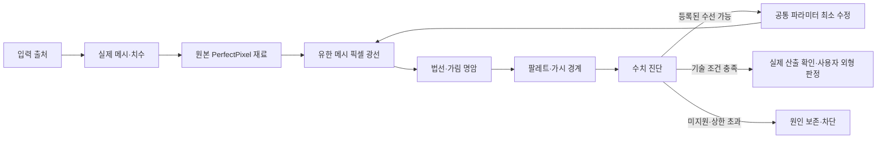

# 실제 픽셀 제작 단계와 수학적 오류 수정

기존 WorkLoop를 실행기로 사용한다. 새 AI/API 호출 없이 고정된 제작 코드를 순서대로 실행하고, 실제 배열·형상에서 나온 진단에만 분기한다. 결과를 만드는 모든 일을 한 ai.work에 넘기는 D20 방식은 사용하지 않는다. 상세 결정/좌표/후보/실패 기준은 [연구 D21](../../docs/references/pixel_desk_shading_research.md)이다.

## 실행

`Run-PixelPipeline.cmd`는 보존된 `LocalOnly/PixelPipeline21/run01` 상태를 이어서 실행한다. 완료 후 다시 눌러도 생성·렌더를 반복하지 않는다. 새 입력/새 계약으로 실행하려면 인자로 새 출력 폴더를 지정한다. 기존 결과를 덮어쓰지 않는다.

```powershell
Tools/PixelPipeline/Run-PixelPipeline.cmd LocalOnly/PixelPipeline21/my-new-run
```

실행 환경은 현재 로컬 Blender5.2와 bundled Python/NumPy/Pillow다. 별도설치·유료요청은 없다. 이 샘플은 기존 실제 책상 메시와 승인 목재를 입력으로 사용하며, 모든 게임 오브젝트를 자동 설계하는 범용 완성품은 아니다.

## 제작 그래프



진단은 오류코드, 담당단계, 해당부품, 측정값, 기대값, 단위, 수선가능여부를 반환한다. 서랍은 전면 폭뿐 아니라 앞판 두께 t를 통과하는 광선도 계산한다. 실제 보이는 틈이2px보다작으면 `DRAWER_GAP_UNDERSAMPLED`, 실제 광선도 앞판에 막히면 `DRAWER_GAP_OCCLUDED`가 발생한다. `g*=t*abs(tanφ)+2/(PPU*abs(cosφ))`로 최소 틈을 계산하고, 앞판 외측 범위를 보존하면서 두 서랍 폭/중심/손잡이를 같은 매개변수에서 재조립한다. 고정96PPU를 올리거나 다리를 개별이동하지 않는다. span5% 상한을 넘으면 자동수정하지 않는다.

긴 평행 면 경계의 양쪽에 선이 찍히면 `BOUNDARY_DOUBLE_STROKE`를 픽셀 단계에 귀속한다. 평행 면은 가까운 면, 비평행 crease는 카메라를 더 향한 면에 선을 놓는 일관된 규칙을 사용한다. 실제 가시 픽셀만 칠하며 깊이 버퍼를 바꾸지 않는다. 선만 수정할 때는 해시를 확인한 raster/shade를 재사용한다. 접합점·외곽 계단의 전역1px 선폭이나 미술 완성도를 이 검사로 보장하지는 않는다.

부족한 모든 디자인을 자동으로 판단하지는 않는다. 고정한 구조·투영·명암 상태·가림·픽셀 규약의 위반을 계산하며, 그림체·색감·무늬 크기의 만족도는 `visual_approval: pending`으로 분리한다. 기술판정이 수학적으로 통과해도 미술완료나99%재현성공이 아니다.

## 단계별 실제 산출

| 단계 | 관찰 가능한 출력 |
|---|---|
| inputs | 입력·계약 SHA, 원본목재 출처 제한 |
| geometry | 실제12솔리드 복사, 치수/접지/서랍 정렬, 이전 재질 제거 |
| material | 원본PerfectPixel66×64 결과,4단계grain, 재료색4개, 원본/코드/ZIP기록 |
| raster | native 픽셀 위치의normal/depth/finite면ID/가림, 실제3D모델 |
| shade | normal·light·shadow에서 만든3단계band와 독립grain,12색palette |
| pixel | 정확한palette/alpha0·255 PNG, 가시선owner, 정수확대미리보기 |
| diagnose/repair | 실제부족의 원인/수치/소유단계, 수정 전후 공통매개변수 |
| package/validate | 수정 전후 이미지,HTML작업그래프/검사표, 실제내용/출처확인 |

최종 그림을 축소한 후 다시 키우는 경로가 아니다. Blender의 BVH를 사용해 출력 픽셀 중심에서 직접 원본3D의 유한 표면을 조회하고 그 위치의 재료/명암을 조합한다. 확대는 표시용이다. 목재의밝기단계화가 순수albedo추출을 증명하는 것은 아니며 승인된 평면재료 출처만 보장한다.

## 변경과 재개

각 단계를 다시 실행할 때 이전 결과를 덮어쓰지 않는다. 입력/출력 receipt와 코드/계약 해시를 확인하고, 코드가 달라지면 보통 run/resume으로 우회하지 않는다. 실행 도중 코드 버그를 수정한 경우는 명시적 recover로 실패한단계부터 새 그래프를 고정하며 이전상태/실패폴더를 보존한다. 완료 후 새 기술 결함을 발견한 경우 reopen은 원인과 대상 파일 SHA를 담은 증거, 실제 코드 변경, 선행 receipt를 요구한다. 이전 진단/제출/검사를 reopening-history에 보존하고 지정 진단에서 이어간다. 외형을 바꾸는 재실행은 새로운 계약/출력폴더에서 수행한다.

## 실제 결과

`LocalOnly/PixelPipeline21/run01/pass-2/package/`에 실제174×155 PNG,6배 nearest 미리보기, 수정 전후 비교, HTML 보고서와 실제3D기하를 저장했다. `desk.blend`는 편집 가능한 기하이며 최종 재료/명암/픽셀 출력은 이 실행기가 만든다. 해당 blend의 F12 결과가 최종PNG와 같다는 뜻은 아니다.

- 서랍 통로: 초기 실제 투과폭0px → 공통 gap 약.065463m로 수정 → 실제2.000003px, 뒤 표면 관측.
- 내부선: 접합점을 제외한 평행 경계의 양면 중복68쌍 →0. 실제 가시 픽셀 소유권과 팔레트/alpha 통과. 남은 전체 경계 교차/실루엣의 두께는 별도 범위다.
- 명암: normal·light·실제 shadow ray에서3단계 band, 승인 목재→원본PerfectPixel→4단계grain을 독립 저장. 최종 고정12색+갈색 경계. 객체 렌더색 재투영 없음.
- 실행 중 진단 JSON의 NumPy bool 직렬화 오류를 수정하고 기존6단계를 보존하여 recover했다. 후속 독립 감사가 찾은 내부선 결함은 명시적으로 reopen하여 수정했다. 판정기가 모든 오류를 최초부터 알고 있었다고 주장하지 않는다.
- 선 단계 복구와 최종출력은3.824초였고 raster/shade는 실행하지 않고 재사용했다. 최초/기하수정 실행의9.679초/6.322초는 개발 중 기록이며 최종 코드의 처음부터 끝까지 생산 속도 보장은 아니다. AI/API 호출과 유료 생성은0회다.
- 그래프 제어19개 subprocess fixture, 실제 수학·오염/범위 차단8개 검사 통과. 재료 모듈6개 확인은 별도 자료다. 자동 판정은 기술 조건이며 현재 외형승인/99%재현/Unity통합은 완료 상태가 아니다.

실무 범위는 이12박스 책상 템플릿과 고정 시점이다. 새로운 종류의 물체는 지지/접합/최소세부/재료방향 등 해당 물체의 계약과 진단을 먼저 등록해야 한다. 규칙 밖 부족을 발견하면 근거와 함께 차단하거나 명시적 재개방으로 진단기를 보완한다. 픽셀 PNG가 존재한다는 이유만으로 해당 오브젝트의 디자인 완료를 선언하지 않는다.
