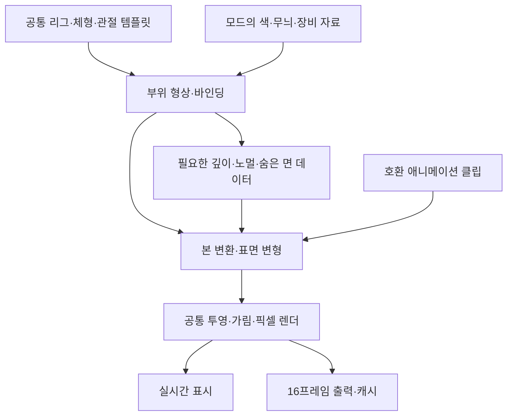

# 픽셀 캐릭터 모딩과 깊이·입체 렌더 파이프라인 연구

조사일: 2026-09-13. 상태: **문헌 조사·설계 제안, 구현·실행 없음**. 기존 [기법별 연구](2d_parts_3d_skeleton_research.md)의 D01을 대체하거나 특정 리그를 채택하는 문서가 아닙니다. 이번 요청은 과거 실패 재진단이 아니라, 깊이·노멀을 포함한 모딩용 제작 방법의 가능성과 조건을 조사하는 것입니다.

관련 지형 자동화: [Unity Rule Tile — 규칙·좌표·타일셋 모딩·현재 3D 지면과의 관계](unity_rule_tile_research.md). 캐릭터 리깅과 별개인 지형 타일 선택 단계입니다.

## 1. 결론과 결정 상태

**[사실] 부위 그림에 깊이를 부여하고 3D 본으로 움직여 다시 픽셀로 그리는 제작 방식은 존재합니다.** Smack Studio가 실제 제품 사례입니다. 그러나 이 사실만으로 해당 렌더러를 Unity에 넣어 외부 모드와 Humanoid 클립을 즉시 처리할 수 있다는 결론은 나오지 않습니다. [공식 기술 개요](https://smackstudio.com/press/)

**[제안] 모딩의 기준 원본은 완성된 16장 이미지보다 `표준 리그 + 교체 가능한 형상·재질 + 동작`에 두는 것이 적합합니다.** 픽셀 출력은 이 원본으로부터 계산하는 파생 결과입니다. 이 구조이면 호환 장비와 클립을 추가할 때 프레임을 손으로 다시 그리는 일을 피할 수 있습니다. 자동 계산·저장 비용까지 없어지는 것은 아닙니다.

**[제안] 작은 몸축 회전·대기 동작에는 C2의 깊이 파츠를 우선 비교하고, 넓은 카메라 범위·전후면·새 3D 동작까지 유지하려면 C5의 공통 입체 표면을 기준으로 비교합니다.** 깊이맵과 노멀맵을 C5 표면에서 자동 생성하면 두 경로가 같은 형상 원본을 사용할 수 있습니다. 이것은 연결 설계안이며, 통합된 제품을 확보하거나 프로젝트 출력으로 입증한 상태는 아닙니다.

**[미정]** 채택 표현, 실제 리그, 체형 템플릿, 숨은 면의 아트, 카메라 지원 범위, 출력 해상도·팔레트·수치 허용오차. 이 문서에서 임의 확정하지 않습니다. 현재 상태표의 CAMERA-01은 카메라 회전·줌을 포함하므로, 정면 근방에서만 성립하는 방법을 전체 카메라 대응으로 간주하지 않습니다. [현재 상태표](../ai/CURRENT_STATE.md)

## 2. 완성 파이프라인 후보 다섯 가지

아래는 입력부터 동작·출력까지 이어지는 후보입니다. 노멀 조명과 자동 프레임 저장은 여러 후보에 붙는 공통 단계이므로 별도의 완성 후보로 세지 않습니다. `적합`은 기술 구조의 비교 판단이며 프로젝트 실행 성적이 아닙니다.

| 후보 | 입력 → 동작 → 픽셀 출력 | 모딩에서 재사용하는 것 | 실패 조건·추가 입력 | 외부 근거와 성숙도 |
|---|---|---|---|---|
| **C1 공통 2D 리그·스킨** | 규격 파츠/메시 → 2D 본·제약·스키닝 → 저해상도 렌더 → 실시간/16장 | 같은 관절 체계의 동작, 슬롯, 호환 스킨 | 입체 회전·투영 길이·새로 보이는 면은 고정 2D 본 각도만으로 표현 불가. 다른 형상은 메시·바인딩 데이터 필요 | Spine의 스킨·linked mesh·런타임은 제품 기능. 자동 통짜 원화 리깅 보장은 아님 |
| **C2 부위별 깊이 스프라이트** | 파츠 색/alpha/깊이 → 공통 3D 본 → 표면 재투영·가림 → 픽셀 출력 | 같은 형상의 깊이·본·동작, 색·무늬 교체 | 가려진 면 부족, 깊이 경계의 막/구멍, 관절 연결부. 허용 시점 밖에서 실패 | Smack Studio의 제작·sprite 출력 사례 확인. Unity 외부 모딩 런타임 연결은 미확인 |
| **C3 여러 층의 깊이 파츠** | 앞·뒤·숨은 표면의 색/깊이 층 → 3D 본 → 층 재투영·합성 → 픽셀 출력 | 리그·클립·층 구조. 저장된 숨은 면을 재사용 | 저장하지 않은 면, 큰 회전의 샘플 부족, 층 경계·투명 정렬. 층 수/데이터 증가 | LDI 원논문은 공개. 이를 캐릭터 모듈·스키닝까지 묶는 부분은 설계 제안 |
| **C4 부위별 복셀 체적** | 팔·몸통·장비의 체적/색 ID → 공통 본의 강체 변환 → 표면 또는 광선 렌더 → 픽셀 출력 | 슬롯·본·클립·재질. 형상 모딩은 셀 데이터 교체 | 셀보다 얇은 구조 소실, 관절 이음부, 부드러운 옷·피부 변형은 추가 기법 필요 | 복셀 데이터 형식은 공개. 복셀 편집기 자체가 이 캐릭터 런타임을 제공한다는 뜻은 아님 |
| **C5 공통 3D 리그·모듈 표면** | 체형 템플릿·입체 파츠·UV/재질 → 3D 클립·스키닝 → 깊이/조명/가림 → 오브젝트별 픽셀 출력 | 가장 넓은 시점·3D 클립·장비 재사용. 깊이·노멀을 원본 표면에서 파생 가능 | 최초 표면/숨은 면/UV/바인딩 필요. 무조건적인 원화 재현·옷 관통 방지·모든 체형 호환은 보장하지 않음 | Unity/Blender 표준 리그·스키닝 경로. 원화와 픽셀 표현의 연결 품질은 별도 미검증 |

C1의 근거는 [Spine Skins](https://en.esotericsoftware.com/spine-skins)·[Spine Unity](https://esotericsoftware.com/spine-unity), C2는 [Smack 기술 개요](https://smackstudio.com/press/), C3는 [Layered Depth Images, SIGGRAPH 1998](https://www.cs.cmu.edu/~ph/869/papers/shade98.pdf), C4의 데이터 분리는 [MagicaVoxel 형식](https://github.com/ephtracy/voxel-model/blob/master/MagicaVoxel-file-format-vox.txt), C5의 바인딩은 [Unity Mesh.bindposes](https://docs.unity3d.com/6000.0/Documentation/ScriptReference/Mesh-bindposes.html)에 근거합니다. 행별 전체 연결이 각 출처의 제품에 모두 들어 있다는 의미는 아닙니다.

Sprite stacking은 C4와 구별합니다. 공간 단면 이미지를 간격을 두고 쌓아 보여 주는 구현은 층 간격·관찰 방향에 따라 틈이 생길 수 있습니다. 완성 스프라이트 한 장을 복제해서 쌓는 것만으로 정확한 체적이나 리그가 생기지 않습니다. [제작자 구현 Shader-Stacker](https://github.com/x3cca/Shader-Stacker)

## 3. 깊이와 노멀로 실제 무엇을 할 수 있는가

### 3.1 노멀은 빛의 반응, 깊이는 위치

높이 표면을 월드와 단위가 일치하는 좌표로 `p(x,y)=(x,y,h(x,y))`라고 하면, 정면을 향하는 표면 법선은 다음과 같습니다.

`n = normalize(-∂h/∂x, -∂h/∂y, 1)`

단순 Lambert 조명은 `I = C · (a + k max(0,n·l))`입니다. 노멀을 바꾸면 이 밝기는 변하지만 `p`의 위치는 변하지 않습니다. 따라서 normal-only는 몸통을 실제로 돌려 옆면이 보이게 하는 단계가 아닙니다. Unity의 2D secondary normal map도 동일 UV의 조명 자료입니다. [Unity 2D normal map](https://docs.unity3d.com/6000.0/Documentation/Manual/urp/SecondaryTextures.html)

반면 깊이를 포함하는 점을 수직축 주위로 회전시키면 `x′ = x cosθ + h sinθ`입니다. 깊이에 따라 화면 위치가 달라지므로 몸통의 미세 비틀기·얼굴의 작은 회전 같은 효과를 계산할 수 있습니다. 이것이 요청하신 효과와 연결되는 기하 단계입니다.

**노멀 그림에서 정확한 깊이가 항상 복원되는 것도 아닙니다.** 표면 기울기로 해석할 수 있는 노멀이라도 경계값·깊이 원점이 필요하고, 임의로 칠한 방향장이 실제 한 표면의 기울기와 일치하지 않을 수 있습니다. 형상을 원본으로 두고 깊이·노멀을 함께 파생시키는 편이 데이터 일관성을 관리하기 쉽습니다.

### 3.2 단일 깊이의 한계는 숫자 보정으로 사라지지 않음

정면 깊이 한 장은 한 광선의 표면 하나만 기록합니다. 팔 뒤의 몸이나 머리카락 뒤의 얼굴은 별도 정보가 없습니다. 재투영 후 생기는 구멍에는 **원래 없던 면의 노출**과 **확대에 따른 샘플 간격**이라는 서로 다른 원인이 있습니다. 보간은 후자를 줄일 수 있지만 숨은 면의 정답을 제공하지는 않습니다. LDI는 광선마다 여러 표면을 저장해 이 문제의 범위를 넓힙니다. [LDI 원논문](https://www.cs.cmu.edu/~ph/869/papers/shade98.pdf)

수치 관계도 있습니다. 출력 해상도가 `ρ` pixel/world-unit이고 깊이 오차가 `δh`라면, 직교 yaw에서 그 오차의 가로 투영 성분은 `δu = ρ δh sinθ`입니다. 따라서 보편적인 “몇 도까지 완벽”이라는 값은 없습니다. 같은 회전도 출력 해상도·두께·가림에 따라 달라집니다. 작은 오차도 픽셀 경계를 넘으면 색이 바뀌므로 이 식만으로 픽셀 일치까지 보장할 수 없습니다.

C3에서도 저장하지 않은 옆면은 남습니다. C4/C5는 완성된 체적·표면에 여러 방향의 정보를 넣을 수 있지만, 그 정보를 최초에 제공하는 과정은 필요합니다.

## 4. 손조절을 줄이는 핵심: 형상 템플릿에서 데이터를 파생

**모드마다 AI가 관절 위치·offset·가중치를 추측하는 절차를 두지 않는 설계가 가능합니다.** 대신 먼저 호환 자산의 입력 규격을 만들어야 합니다.

이는 제안한 구조입니다. 템플릿을 정했다는 이유로 임의 원화가 자동 호환되었다고 판정하지 않습니다.

### 4.1 형상 자료를 만드는 세 가지 입력 경로

1. **규격에 맞춘 외형 교체:** 기존 형상·UV·관절을 유지하고 색/문양만 교체합니다. 깊이·노멀·바인딩은 기존 데이터를 재사용합니다. 표면의 요철까지 바뀌면 노멀 자료도 변경 대상입니다.
2. **매개변수 체형 템플릿:** 팔 길이·두께·몸통 폭 등 명시된 매개변수에서 표면과 기준 관절을 함께 생성합니다. 통나무·캡슐 같은 단순 입체도 이 경로의 기준 형상으로 사용할 수 있습니다. 정확하게 계산되는 것은 그 템플릿이 정의한 형상이며, 임의 캐릭터 디자인의 정답이라는 뜻은 아닙니다. 매개변수로 표현하지 못하는 새 장식·옷 형태는 별도 모듈 자료가 필요합니다.
3. **실루엣 기반 입체 부풀리기:** 닫힌 윤곽에서 두께 있는 표면을 만드는 기존 알고리즘이 있습니다. Teddy는 윤곽의 삼각분할·중심 구조로부터 내부를 들어 올리고 반대편을 연결합니다. 넓은 곳은 두껍게 만드는 형상 가정에 따른 생성이며, 그림에 없던 실제 신체를 알아내는 과정은 아닙니다. [Teddy 원논문, SIGGRAPH 1999](https://www-ui.is.s.u-tokyo.ac.jp/~takeo/papers/siggraph99.pdf)

Teddy는 형상 생성 단계의 근거입니다. 픽셀 캐릭터의 관절·리깅·텍스처·새 동작까지 완성하는 도구라는 근거는 아닙니다. 현재 설치 호환성도 이번에 확인하지 않았습니다.

모드 제작자가 그림만 넣는 경험을 원하면 **그림을 템플릿의 지정 영역에 맞추는 것** 또는 **그림을 템플릿에 맞추는 별도 추정·저작 단계**가 필요합니다. 후자를 생략하고 서로 다른 크기·관절의 그림을 단순 정규화하면, 정확한 수학으로도 다른 모양이 나옵니다. 그림의 alpha bounding box를 각 부위마다 같은 크기로 맞추는 방법은 관절 정규화가 아닙니다.

## 5. 좌표·정규화·바인딩의 수학 계약 초안

이 절은 식의 의미를 고정한 연구 초안입니다. 프로젝트의 수치·실제 축 대응·허용오차까지 채운 구현 명세는 아닙니다.

### 5.1 표현 공간

| 공간 | 규격으로 저장할 내용 |
|---|---|
| 원본 이미지 | 픽셀 중심 좌표, u 오른쪽/v 아래쪽, 원본 canvas와 crop 위치, alpha |
| 캐릭터 기준 공간 | 길이 단위, 기준 체형·자세, 해부학적 좌우, 모든 파츠가 공유하는 scale과 anchor |
| 부위/본 로컬 | 부모 본, 관절 원점, 축, 기준 본 행렬, 표면→본 bind 행렬 |
| 렌더 카메라 | 위치·기저·투영, 근/원거리, 허용 시점 영역 |
| 출력 픽셀 | 폭/높이, pixels-per-unit, 공통 crop·pivot, 격자 위상, 팔레트·alpha·색공간 |

설명용 기준은 오른손 좌표의 `+X=오른쪽, +Y=위, +Z=기준 정면 쪽`입니다. 이미지 `(u,v)`를 해당 공간으로 옮기는 직교 표현은 다음과 같습니다.

`p = ((u-cu)/s, (cv-v)/s, d(u,v))`

`s`는 원본 pixel/unit, `(cu,cv)`는 공통 이미지 기준점, `d`는 같은 길이 단위의 깊이입니다. crop된 파츠는 먼저 원본 canvas의 위치를 복원합니다. 파츠마다 임의 scale을 만들지 않습니다. 원근 카메라의 Z 깊이에는 이 식 대신 카메라 내부행렬에 따른 역투영이 필요합니다. 상대깊이·역깊이·광선 거리도 같은 데이터가 아닙니다. [Open3D 공식 depth 역투영](https://www.open3d.org/docs/release/python_api/open3d.geometry.PointCloud.html)

엔진으로의 단위·기저 변환을 `A`로 정의하면 점은 `p_target=A p`로 옮깁니다. 본 로컬과 월드에 같은 좌표 변환 A를 적용하는 경우 `J_target=A J A⁻¹`입니다. 두 공간의 변환이 다르면 일반식은 `J_target=A_world J_source A_local⁻¹`입니다. handedness 반전이 있으면 삼각형 방향·노멀·접선의 방향도 대응시켜야 합니다. 좌표 부호를 이미지 단계와 본 단계에서 각각 추측해 고치지 않습니다.

### 5.2 강체 파츠와 부드러운 스키닝의 보장 범위

기준 자세에서 mesh local→world가 `H_r`, 본 local→world가 `J_i(r)`이면 다음과 같습니다.

`B_i = J_i(r)⁻¹ H_r`

`p_world(t) = J_i(t) B_i p_mesh`  — 한 본에 붙은 강체 부위

`p_world(t) = Σ_i w_i J_i(t) B_i p_mesh`  — LBS, `w_i≥0, Σ_i w_i=1`

bind 행렬과 본 배열의 대응은 Unity 표준 계약입니다. [Unity Mesh.bindposes](https://docs.unity3d.com/6000.0/Documentation/ScriptReference/Mesh-bindposes.html)

강체 경로에서 길이 보존 변환만 사용하면 부위 내부 점 사이의 거리를 보존합니다. 따라서 머리·상완·장비 각각의 내부를 종이처럼 접어 버리는 변형은 발생하지 않습니다. 다만 서로 다른 강체 부위 사이의 연결·겹침·노출되는 관절 면은 별도로 설계해야 합니다. 부드러운 피부와 옷의 요구를 강체 파츠로 몰래 바꾸어서는 안 됩니다.

LBS는 표준 알고리즘이어도 모든 회전에 부피를 보존하지 않습니다. 예를 들어 `0.5 I + 0.5 Rz(π) = diag(0,0,1)`이므로 단면이 붕괴할 수 있습니다. DQS는 회전 혼합의 이런 축소를 줄이는 근거가 있지만, 메시 전체 자기교차·옷 관통까지 자동 방지하지는 않습니다. Blender의 Preserve Volume 설정이 Unity의 스키닝으로 그대로 이식된다고 가정하지도 않습니다. [DQS 원논문](https://users.cs.utah.edu/~ladislav/kavan07skinning/kavan07skinning.pdf), [Blender Armature](https://docs.blender.org/manual/en/latest/modeling/modifiers/deform/armature.html)

본 이름이 같다는 것, topology가 같다는 것, UV가 같다는 것은 각각 다른 조건입니다. 클립 공유에는 관절 의미·기준 자세·리타게팅 계약이, 가중치의 직접 복사에는 정점 대응이, 텍스처 직접 교체에는 UV 대응이 필요합니다. 다른 메시·UV의 장비도 적절하게 바인딩하면 같은 본으로 움직일 수 있습니다.

### 5.3 표현별 렌더링 연결

다음은 표준 기하·합성식으로 기술한 후보 연결입니다. Smack Studio의 내부 코드를 복원한 식이 아닙니다. `P,V`는 각각 투영·view 행렬이고, 원근 투영은 clip 좌표를 w로 나눈 뒤 화면으로 옮깁니다.

| 후보 | 변형 후 화면으로 가는 계산 | 그 계산이 해결하지 않는 것 |
|---|---|---|
| C1 | 평면 동차좌표와 3×3 본/바인드 행렬로 §5.2의 강체 또는 가중 변환을 적용. 삼각형 안에서 UV를 보간하고 slot 순서·alpha로 합성 | 화면 밖 깊이와 가려진 면은 2D affine 변환에 없음 |
| C2 | 깊이로 얻은 `p`를 `p_clip=P V J_i B_i p`로 이동. 깊이 불연속을 분리한 표면 래스터화 또는 규정된 splat으로 샘플 채움. 몸·장비 사이 깊이 비교 | 불연속을 가로지르는 잘못된 삼각형, 없는 면의 색 |
| C3 | 한 화소의 여러 `(d_j,C_j,alpha_j)`를 각각 재투영. 순서가 정해진 premultiplied 표면은 `C_out=C_front+(1-alpha_front)C_back`으로 합성 | 움직인 여러 파츠의 전역 순서를 원본 이미지의 층 번호만으로 결정할 수 없음 |
| C4 | 셀 크기 `h`의 위치 `p=h(i+1/2,j+1/2,k+1/2)`와 occupancy/material을 보유. 본으로 변환한 셀의 경계면 또는 광선의 첫 유효 교차를 렌더 | 강체 변환은 관절 사이 연속 피부를 자동 생성하지 않음. 셀의 공간 격자와 화면 픽셀 격자는 다름 |
| C5 | 스키닝 정점을 `P V`로 투영, 깊이 검사와 삼각형 UV/normal 보간으로 재질 평가. normal 변환은 적절한 역전치 또는 변형 표면에서 재계산 | 올바른 래스터화가 잘못된 바인딩·몸 관통·누락된 아트를 복구하지는 않음 |

LDI 원논문의 효율적인 순회 순서는 원논문의 표현·변환 조건에 따른 것입니다. 독립 본으로 움직이는 여러 LDI 파츠를 합칠 때 그 순서가 그대로 유효하다고 가정하지 않습니다. [LDI 원논문](https://www.cs.cmu.edu/~ph/869/papers/shade98.pdf)

## 6. 픽셀 출력과 16프레임의 동일성

공통 원본을 `C`, 최종 자세를 `A`, 카메라·조명을 `V,L`, 렌더·픽셀 출력 규칙을 `Q`라고 하면 다음과 같이 정의할 수 있습니다. 여기서 `A(t)`는 같은 초기 상태와 입력으로 클립 및 모든 제약을 평가한 자세입니다. 상태 전이·IK 목표·물리·누적 root motion이 달라지면 시간만 같아도 출력은 달라집니다.

`F_k = Render(C, A(kT/N), V, L; Q), k=0…N-1`

16프레임이면 `N=16`입니다. 루프의 마지막 `T`를 중복 포함하지 않습니다. 런타임도 같은 16개 위상으로 표시하면 저장 이미지와 비교할 시간 기준이 같습니다. 연속 시간의 본 애니메이션과 16장 계단 재생을 서로 다른 시각에 비교하면 같지 않습니다.

**가장 직접적인 동일성 경로는 같은 렌더 타깃을 화면 표시와 무손실 PNG 저장에 함께 사용하는 것입니다.** 다른 프로그램·다른 스키닝·다른 gamma/필터로 다시 렌더하면서 “같은 본이므로 같은 픽셀”이라고 보장하지 않습니다. PNG를 다시 사용할 때도 색공간·alpha·보간 설정이 같아야 합니다. 서로 다른 GPU/플랫폼의 비트 단위 결정성은 별도 요구입니다.

Spine도 골격 데이터 출력과 이미지 시퀀스 출력, 명령행 자동 내보내기를 지원합니다. 이는 같은 제작 원본에서 여러 출력 형태를 만드는 실제 사례이며, 모든 런타임과 편집기의 픽셀 단위 일치를 보장한다는 뜻은 아닙니다. [Spine Export](https://esotericsoftware.com/spine-export)

`Q`에는 다음을 한 번 정해 넣습니다.

- 캐릭터 전용 출력 해상도, 공통 anchor와 시간 전체에 공통인 canvas. 프레임별 자동 bbox 정규화로 몸 크기를 바꾸지 않습니다.
- 출력 격자에서의 래스터화, 선택한 텍스처 샘플링과 alpha 규칙. 본/정점을 각각 정수 위치에 붙이는 것은 별도 변형이므로 혼동하지 않습니다.
- 애니메이션 전체에 공통인 팔레트·색 단계. 프레임마다 서로 다른 팔레트를 추정하면 색이 흔들릴 수 있습니다.
- 모든 몸·장비 표면을 함께 고려하는 깊이/가림. 장비 PNG를 마지막에 무조건 위에 올리는 것으로 몸 앞뒤를 감싸는 장비를 처리하지 않습니다.

이미 명암이 그려진 픽셀 원화에 동적 조명을 곱하면 명암이 중복될 수 있습니다. 원래 명암을 유지할지, albedo·재질 ID와 명암 팔레트를 분리할지는 아트 요구에 따라 결정해야 합니다. 후자가 새로운 디자인을 자동 승인하는 것은 아닙니다.

**원본 픽셀 배열을 모든 회전에서도 그대로 유지하는 것과 입체 회전은 다른 요구입니다.** 회전하면 투영·가림이 바뀌므로 픽셀 배치도 바뀝니다. 여기서 계약으로 만들 수 있는 것은 고정 격자·팔레트·샘플링·공통 렌더 출력입니다. 그 결과의 픽셀아트 완성도는 별도의 시각 판단입니다.

PerfectPixel은 출력 정규화 단계의 후보입니다. 깊이·관절·숨은 면을 만드는 단계가 아닙니다. 처음부터 목표 격자와 팔레트로 렌더했다면 추가 후처리 없이 출력하는 경로도 비교할 수 있습니다. 이번 조사에서는 로컬 개조판의 동작을 다시 분석하거나 실행하지 않았으므로 제거를 확정하지 않습니다.

기존 생성 영상의 16장에 정확히 대응하는 리그를 복원하는 것은 별도 역문제입니다. 위의 같은 원본→같은 출력 식이 그 역변환을 제공하지 않습니다.

## 7. 실제 모드 작성 계약

| 변경하려는 것 | 모드가 제공할 것 | 재사용 가능한 것 | 새 프레임 손그림 필요 여부 |
|---|---|---|---|
| 색·문양 | 규격 텍스처/팔레트 | 형상·깊이·리그·클립 | 필요 없음 |
| 같은 형상의 의상 | 같은 UV/영역의 재질, 필요시 normal | 형상과 바인딩 | 필요 없음 |
| 큰 모자·돌출 갑옷·다른 머리 | 해당 alpha와 깊이/입체 형상, 표준 slot/socket 또는 본 바인딩 | 공통 본·호환 클립 | 매 프레임 저작 불필요. 최초 새 형상 자료 필요 |
| 새 3D 애니메이션 | 공통 리그용 클립 또는 정의된 retarget 자료 | 호환 몸·장비·렌더러 | 매 프레임 저작 불필요. 새 자유도/시점이 기존 자료 범위를 넘으면 그 범위는 미지원 |
| 다른 체형 | 템플릿 매개변수 또는 새 표면·기준 관절·바인딩 | 의미가 맞는 관절·동작 | 체형 적용 단계 필요. 클립마다 보정하는 구조는 목표와 다름 |
| 추가 팔·날개 등 새 구조 | 새 리그 유형/추가 본 모듈과 그것을 구동하는 자료 | 공통 부분 | 기존 인간형 클립만으로 새 부위 동작까지 생기지는 않음 |

Unity Humanoid retargeting은 구성된 인간형 Avatar 사이의 애니메이션 재사용 기능입니다. 장비 맞춤·발 접지·무기 접촉까지 모든 체형에서 자동 일치한다는 보장은 아닙니다. [Unity Retargeting](https://docs.unity3d.com/6000.0/Documentation/Manual/Retargeting.html)

모드 자료에는 최소한 `rig/schema version`, 파츠/슬롯 의미, 길이 단위·기준 자세, 자료 참조, 지원 시점·관절 범위가 있어야 합니다. 지원 범위 밖의 자료는 해당 이유를 보고해야 하며 AI가 임의 offset이나 다른 그림으로 조용히 대체하지 않습니다. 수식·계약을 확인하는 것은 자동화의 성립 조건이며, 매 프레임 AI의 미술 판단을 넣는 절차와 다릅니다.

## 8. 처리 속도와 자동 캐시

리그·자료가 준비된 뒤의 본 변환·가림·픽셀 렌더는 프로그램 계산입니다. 새 프레임마다 언어모델을 호출할 이유가 없습니다. 생성형 AI를 자료 제작에 사용하더라도 그것은 이 재생 경로와 분리할 수 있습니다.

출력 비용은 클립 수 `C`, 방향 수 `D`, 프레임 수 `N`, 장비 조합 수 `K`에 대해 대략 `C·D·N·K`개의 렌더/출력으로 증가합니다. 이는 작업량의 구조이며 처리 시간 측정값은 아닙니다. 장비 조합 전체를 미리 만들기보다 사용하는 조합을 자동 생성·캐시하는 방법이 후보입니다. 의상·무기별로 평면 이미지 한 장씩만 합치는 방식은 깊이 가림을 일반적으로 보존하지 못합니다.

캐시 키에는 원본 형상/재질/리그 버전, 클립·시간 또는 혼합 상태, 카메라, 조명, 픽셀 규칙을 넣습니다. 실시간 IK·연속 카메라·동적 조명을 모두 키로 만들면 캐시 공간이 커지므로 그 구간은 실시간 렌더가 더 적합할 수 있습니다. 최종 PNG만 저장하면 동적 재조명 정보가 사라지며, 이를 유지하려면 normal/depth 등 추가 버퍼 또는 실시간 원본이 필요합니다.

현 프로젝트에서 후보별 처리 시간을 측정하지 않았습니다. “10초”, “100배” 같은 수치를 이 조사로 약속하지 않습니다. 현재 영상 후처리의 실행 시간과 게임 내부의 리그 렌더 비용도 서로 다른 작업입니다.

## 9. 제품 경계, 미해결 사항과 재개 조건

**Smack Studio 확인 범위:** 파츠→3D 본→자동·편집 가능한 깊이→UE4 compute 재렌더→spritesheet 출력. 제작 과정에는 깊이 편집과 필요시 프레임 보정이 포함됩니다. 현재 제품 설명은 최대 256×256 canvas, 적합한 캐릭터 높이 50–150px를 안내하며 그 범위를 크게 벗어나면 수동 cleanup이 늘 수 있다고 설명합니다. [공식 제품 설명](https://store.steampowered.com/app/1739300/Smack_Studio/), [높이맵 제작 소개](https://smackstudio.com/here-is-our-technique-for-animating-3d-without-using-3d-models/)

**미확인:** 공개 Unity 런타임·SDK·렌더러 소스, 외부 FBX/BVH/Humanoid 모션 입력, rig/depth를 보존하는 외부 출력. 기술 개요는 확보했지만 상세 알고리즘을 담은 제품 소스·특허 명세서는 이번 제한된 검색에서 확보하지 못했습니다. 존재하지 않는다는 단정은 아닙니다. 높이맵 소개는 검색 본문으로 확인했으며 직접 페이지 열기는 실패했습니다.

**자동 입체 생성의 공백:** 표준 형상 생성과 표준 스키닝이 각각 존재해도, 현재 한 장의 원화에서 숨은 면·옷 구조·관절까지 완성하는 전체 경로가 입증된 것은 아닙니다. 이 공백을 해소하는 제안은 입력 템플릿·범위를 명시하는 것입니다. 임의 이미지 전체에 대한 완벽 복원 보장을 추가하지 않습니다.

**다음 최소 판별 설계 — 미실행:** C2/C5 비교를 재개할 때, 같은 규격의 몸·장비 자료와 같은 clip을 사용해 (1) 기준 자세와 한 관절 회전의 공간 계약, (2) 의도한 시점 범위의 가림·관절 연결, (3) 제작에 쓰지 않은 호환 clip과 새 장비 하나를 프레임 재저작 없이 수용하는지 확인합니다. 픽셀 출력은 실제 16장 연속 재생으로 비교합니다. 매 프레임 AI 평가·수치 보정 루프는 계획에 포함하지 않습니다. 실제 범위와 허용오차는 구현 전 확정할 필드입니다.

**증거 상태:** 공식 문서·공개 논문의 방법과 제품 경계를 비교했습니다. 캐릭터·rig·renderer 설치/수정/실행, 성능 측정, 새 이미지·영상 생성, Unity Play Mode 검증은 수행하지 않았습니다. 연구 후보와 필요한 계약을 구체화했으며, 캐릭터 제작 성공이나 프로덕션 채택 완료로 기록하지 않습니다.
