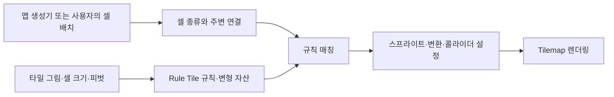

# Unity Rule Tile — 규칙 기반 지형 배치와 프로젝트 적용 범위

조사일: 2026-09-14. **[현재] RuleTile 패키지는 설치하지 않았습니다.** 후속 맵 작업에서 기존 3D 격자에 역할별 가중 랜덤 표현을 연결했습니다. 아래 공식 RuleTile 조사와 현재 프로젝트의 구현 범위를 구분합니다.

현재 구현은 `IsometricUrbanStyle`의 Ground/Sidewalk/Road 후보·weight → `hash(seed,x,z)` → 누적확률 선택입니다. 같은 seed와 설정은 같은 타일을 고르고, 도로망·교차부·차선 방향은 기존 road graph가 정합니다. 밝은 Ground/Sidewalk는 기본6:금간타일1, Road는 기본960:금간도로96:맨홀11입니다. 후보 배열에 같은 용도의 정규화된 면을 추가할 수 있습니다. 전체 원본시트 정규화와 실제 실행 근거는 [맵 파이프라인 D05](isometric_urban_map_pipeline.md)에 있습니다. 이는 Unity RuleTile/WeightedRandomTile 클래스를 설치·연결한 결과가 아닙니다.

## 1. 기능과 현재 결정

**Rule Tile은 셀 주변의 타일 관계를 검사해서 스프라이트·방향·출력을 선택하는 자동 타일 기능입니다.** 예를 들어 같은 도로를 칠해도 주변 연결에 따라 끝, 직선, 모서리, T자, 교차로를 선택하도록 규칙을 작성할 수 있습니다. 이미 준비한 그림과 규칙을 재사용하는 방식입니다. [Unity Rule Tile 제작 문서](https://docs.unity3d.com/Packages/com.unity.2d.tilemap.extras@8.0/manual/RuleTile.html)

| 항목 | 판단 |
|---|---|
| 제공 패키지 | Unity의 `com.unity.2d.tilemap.extras`(2D Tilemap Extras). 기본 Tilemap 모듈과 별도입니다. |
| 프로젝트 버전 | [ProjectVersion.txt](../../ProjectSettings/ProjectVersion.txt): Unity `6000.5.9f1`. 공식 Unity 6000.5 패키지 표에는 Extras `8.0.3`이 released로 기재되어 있습니다. |
| 현재 설치 근거 | [manifest](../../Packages/manifest.json)·[lock](../../Packages/packages-lock.json)에 Extras가 없습니다. `com.unity.modules.tilemap`만으로 Rule Tile이 설치되었다고 판단하지 않습니다. `Assets`·`Packages`의 RuleTile 이름 파일 검색도 일치 항목이 없었습니다. |
| 맡길 수 있는 부분 | 지면 경계, 벽·울타리·물가 연결, 장식 변형과 애니메이션 타일, 동일 규칙을 쓰는 다른 타일셋. |
| 별도 단계 | 도로망·방·탈출 경로 생성, 접근성·게임 규칙 판정, 캐릭터 리깅, 2D→3D 복원, 픽셀화, 외부 모드 로딩. |
| 결정 | RuleTile 패키지 이관은 보류합니다. 현재 3D 생성기에 역할별 후보와 가중 랜덤 선택을 연결했으며, 연결 관계는 기존 격자/도로망이 소유합니다. |

버전 근거: [Unity 6000.5 — 2D Tilemap Extras](https://docs.unity3d.com/6000.5/Documentation/Manual/com.unity.2d.tilemap.extras.html). 버전 표는 설치 가능성의 근거이며 이 프로젝트에서 실행해 호환성을 확인했다는 뜻은 아닙니다.

## 2. 제작·실행 파이프라인



준비 과정은 `타일셋 분할 → Rule Tile 생성 → 이웃 조건과 출력 그림 지정 → Tile Palette에 등록`입니다. 이후 셀을 칠하거나 코드로 배치하면 규칙을 평가합니다. 규칙 변경도 배치 결과에 반영됩니다. **실행 단계에서 타일마다 AI가 모양을 판단할 필요가 없습니다.** AI를 사용한다면 최초 규칙·입력 자료 작성 등 담당 범위에 사용하고, 반복 선택은 엔진이 계산합니다. [공식 제작 절차](https://docs.unity3d.com/Packages/com.unity.2d.tilemap.extras@8.0/manual/RuleTile.html)

맵의 셀 배치가 입력이므로 Rule Tile만으로 생환 가능한 맵 전체가 만들어지는 것은 아닙니다. 이 구분은 입력·출력 범위에서 도출한 해석입니다. 규칙이 올바른 그림을 선택해도 원래 도로망이 끊겨 있다면 연결된 길로 고쳐 주지 않습니다.

## 3. 수학적 모델과 실패 조건

### 3.1 이웃 조건과 규칙 우선순위

셀 좌표를 `p ∈ Z²`, 주변 오프셋을 `d`, 배치된 타일을 `T(p)`라고 둡니다. 기본 직사각형 편집기는 중심 주변 8칸을 표시하며 이웃 범위를 확장할 수도 있습니다.

| 조건 | 의미 | 흔한 오해 |
|---|---|---|
| Don't Care / 빈 표시 | 그 이웃을 검사하지 않음 | 빈 셀이어야 한다는 뜻이 아닙니다. |
| This / 초록 화살표 | 같은 Rule Tile에 해당하는 이웃 | 그림이 비슷하거나 같은 재질 이름이면 같다는 뜻이 아닙니다. |
| Not This / 빨간 표시 | 같은 Rule Tile이 아닌 이웃 | 빈 셀에만 한정되지 않습니다. 다른 타일도 포함합니다. |

출력은 Single, Random, Animation으로 나뉩니다. 매칭 규칙은 스프라이트와 GameObject, Collider 설정을 지정할 수 있습니다. [Inspector 공식 정의](https://docs.unity3d.com/Packages/com.unity.2d.tilemap.extras@8.0/manual/RuleTile-Inspector.html)

규칙 `j`의 조건을 `C(j,d)`라고 하면, 기본 매칭은 다음 논리곱으로 표현할 수 있습니다. `same`은 해당 구현의 타일 동일성 판정입니다.

```text
test(*, t)        = true
test(This, t)     = same(t, self)
test(NotThis, t)  = !same(t, self)
match(j, p)      = AND over d of test(C(j,d), T(p+d))
selected(p)      = first matching rule in authored order
```

회전·반전을 허용하면 지정된 변환 집합 `G(j)`의 각 `g`에 대해 `T(p + g·d)`를 검사하는 것으로 확장됩니다. 정사각형의 90도 회전은 정수 격자를 보존하고, 축 반전은 두 번 적용하면 원래 좌표로 돌아옵니다. 타일 그림이 비대칭 조명·글자·방향성을 갖는다면 같은 기하 규칙이라도 회전/반전 재사용이 시각적으로 적합하지 않을 수 있습니다.

**[실패 조건]** 넓은 조건을 먼저 배치하면 뒤의 구체적인 조건을 가릴 수 있습니다. 순서를 성능 목적으로 바꿀 때도 출력 의미를 보존해야 합니다. 매칭이 없으면 기본 출력이 사용되므로, 기본 그림이 보인다는 것만으로 규칙이 완전하다고 판정할 수 없습니다. 공식 문서는 위에서부터 검사하는 순서를 설명합니다. 정적 타일과 애니메이션의 세부 선택 경로는 §7의 소스 범위도 참고합니다. [규칙 순서](https://docs.unity3d.com/Packages/com.unity.2d.tilemap.extras@8.0/manual/RuleTile.html#optimize-multiple-rules)

### 3.2 연결 마스크와 현재 프로젝트의 기존 알고리즘

4방향 연결을 `bN,bE,bS,bW ∈ {0,1}`로 두면 `m = bN + 2bE + 4bS + 8bW`로 16가지 경우를 구별할 수 있습니다. 이는 규칙을 설명하기 위한 마스크 예이며 Unity Rule Tile이 항상 16항목 테이블로 실행된다는 주장은 아닙니다.

8방향 원시 마스크는 256가지입니다. 지면을 채우는 blob 방식에서는 대각선을 양쪽 직교 연결이 있는 경우에만 인정합니다. 예를 들어 `bNE' = bNE AND bN AND bE`입니다. 이 조건으로 정규화한 마스크는 47가지입니다. 반면 대각선 도로의 실제 진행 방향은 지면 채움 여부와 다른 정보입니다.

**[코드 확인] 프로젝트에는 이 정규화가 이미 있습니다.** [UrbanSurfaceGrid.cs](../../Assets/Scripts/WorldGeneration/UrbanSurfaceGrid.cs)의 `ComposeCanonicalSurfaceMask`가 네 대각선을 위 조건으로 계산하며, `GetRoadPortMask`는 실제 도로 방향을 별도로 보존합니다. `AreAutotileCompatible`은 주도로와 보조도로를 같은 연결 계열로 취급합니다. 이를 기본 Rule Tile의 자산 동일성으로 단순 치환하면 현재 의미가 달라질 수 있습니다.

47가지 경우가 있다는 사실만으로 그림 47장을 반드시 따로 그려야 한다거나, Rule Tile이 해당 규칙을 자동으로 작성한다는 뜻은 아닙니다. 회전 재사용 가능성과 타일셋 규격에 따라 저작량이 달라집니다.

### 3.3 좌표·픽셀 정규화

기준 원본은 `셀 종류 + 연결 규칙 + 타일셋 매핑`입니다. 렌더된 픽셀을 다시 읽어 맵 원본으로 삼지 않습니다. 다음 식은 간격이 0이고 정사각형 셀인 경우의 설계 표현입니다.

```text
cell center(i,j) = origin + s·(i+1/2)·e1 + s·(j+1/2)·e2
```

`s`는 셀의 월드 단위 크기, `e1,e2`는 셀 평면의 단위 축입니다. 일반 2D XY와 프로젝트의 XZ 지면은 다른 embedding입니다. 프로젝트 `GetCellCenter`는 이미 `LocalOrigin + TileSize·(x+0.5,z+0.5)`를 쓰며, `TryLocalToCell`은 원점을 뺀 뒤 바닥함수로 셀을 구합니다. 음수 위치를 정수 절삭으로 바꾸면 경계가 틀어질 수 있습니다.

Unity Tilemap을 택한다면 Grid/Tilemap의 좌표 API와 tile anchor를 따릅니다. `CellToWorld`의 직사각형 셀 모서리와 `GetCellCenterWorld`의 기준점을 혼용하지 않습니다. [Tilemap.GetCellCenterWorld](https://docs.unity3d.com/6000.0/Documentation/ScriptReference/Tilemaps.Tilemap.GetCellCenterWorld.html)

**[설계 관계]** 한 셀을 꽉 채우는 정사각형 스프라이트가 `n`픽셀이고 부모 스케일이 1이면 `PPU = n/s`입니다. 피벗·tile anchor·아틀라스 여백도 통일해야 합니다. Rule Tile은 선택 기능이므로 텍스처 필터링, 카메라 투영, 픽셀 격자 정렬을 대신하지 않습니다. 회전하는 3D 카메라에서 화면상 픽셀 일치를 자동 보장하지도 않습니다. 이 기능에는 본·가중치·리깅 단계가 없습니다.

### 3.4 Random·Animation의 재현성과 청크 경계

**[공개 master 소스 확인]** Random 스프라이트 선택은 셀 좌표·Perlin Scale·고정 offset을 사용합니다. 반면 Animation 속도는 `Random.Range`로 선택됩니다. 전자는 입력이 같으면 반복되는 공간 변형이며, 게임의 원정 seed를 받는 전역 맵 생성기와 동일하지 않습니다. 재생 시점·속도까지 포함한 결정성을 기본 기능만으로 가정하지 않습니다.

`GetTileData`와 달리 `GetTileAnimationData`는 Animation 규칙만 따로 순회합니다. 따라서 Single 규칙과 Animation 규칙이 겹치는 경우에는 §3.1의 첫 매칭만으로 최종 재생을 설명할 수 없습니다. 또한 기본 이웃 조회는 같은 Tilemap을 대상으로 하므로 별도 Tilemap에 나눈 청크가 시각적으로 접한다고 연결 조건이 자동 공유되지는 않습니다. 이는 공개 master 기준의 주의점이며 8.0.3 설치본 검증 결과는 아닙니다. [공식 RuleTile 소스](https://github.com/Unity-Technologies/2d-extras/blob/master/Runtime/Tiles/RuleTile/RuleTile.cs)

## 4. Rule Override Tile·Auto Tile·모딩

| 선택지 | 맡기는 일 | 적합 조건 |
|---|---|---|
| Rule Tile | 직접 정의한 이웃 조건에 따른 출력 | 지형별 예외·연결 규칙을 명확히 통제할 때 |
| Rule Override Tile | 같은 규칙에서 스프라이트·프리팹 교체 | 눈·풀·사막 등 동일 구조 타일셋의 변형 |
| Auto Tile | floor/wall 배치 마스크에 따른 타일 선택 | 규정된 정사각형 타일셋으로 바닥·복도·모서리를 구성할 때 |
| 현재 지면 메시 + 기존 연결 마스크 | 현재 3D 지면과 규칙 데이터에 타일셋 매핑 연결 | 기존 카메라·3D 물리·도로 데이터 계약을 유지할 때 |

Rule Override Tile은 원본 출력에 대응하는 그림·프리팹을 교체하고, 비워 둔 항목은 원본을 사용합니다. 따라서 **타일셋 스킨을 재사용하는 구조의 후보**입니다. 하지만 외부 PNG 폴더를 그대로 게임 모드로 읽는 로더, 안정 ID, 규칙 호환성, 자산 참조 연결은 별도로 필요합니다. [Override 공식 문서](https://docs.unity3d.com/Packages/com.unity.2d.tilemap.extras@8.0/manual/RuleOverrideTile.html)

현재 8.0 문서의 **Auto Tile**도 함께 보관할 가치가 있습니다. 2×2 또는 3×3 floor/wall 배치용 스프라이트시트에 마스크를 지정하는 절차를 제공하며, Rule Tile 규칙을 개별 작성하는 부담을 줄입니다. 임의 그림에서 의미를 알아내는 생성 AI 기능은 아닙니다. [Auto Tile 공식 제작 절차](https://docs.unity3d.com/Packages/com.unity.2d.tilemap.extras@8.0/manual/AutoTile.html)

**[공개 소스의 동일성 경계]** Override는 내부 Rule Tile 인스턴스를 만들어 실행합니다. 같은 원본을 공유하는 별개의 Override가 기본 `This` 판정에서 같은 지형으로 연결된다고 가정하면 안 됩니다. 계절·스킨을 섞는 모딩에는 자산 이름과 별개인 연결 계열 계약이 필요합니다. [공식 RuleOverrideTile 소스](https://github.com/Unity-Technologies/2d-extras/blob/master/Runtime/Tiles/RuleOverrideTile/RuleOverrideTile.cs), [RuleMatch 구현](https://github.com/Unity-Technologies/2d-extras/blob/master/Runtime/Tiles/RuleTile/RuleTile.cs)

## 5. 프로젝트 적용 판단

**[코드 확인]** [ProceduralUrbanMapGenerator.cs](../../Assets/Scripts/WorldGeneration/ProceduralUrbanMapGenerator.cs)의 `CreateSurfaceTiles`는 XZ 지면의 쿼드를 합쳐 `MeshFilter`·`MeshRenderer`로 출력하고, 지면에는 3D `BoxCollider`를 만듭니다. 조사한 이 경로는 Unity 2D Tilemap 렌더러를 사용하지 않습니다. 연구 시점의 기준 상태는 [CURRENT_STATE.md의 MAP-01](../ai/CURRENT_STATE.md)입니다.

**[제안] 현재 연결 마스크를 지면 아틀라스 선택에 사용하는 경로와, Unity Tilemap으로 표현하는 경로를 비교합니다.** Rule Tile 설치만으로 기존 메시가 Rule Tile로 전환되지는 않습니다. 후자를 선택할 때는 좌표 embedding, 깊이·그림자, 충돌, NavMesh, 청크 수명 연결을 설계해야 합니다. Rule Tile의 Collider 설정과 3D 충돌 데이터를 동일한 것으로 취급하지 않습니다.

**[제안] 원본 맵 데이터의 소유자는 기존 생성기·레이아웃에 둡니다.** Rule Tile 또는 메시 렌더링은 파생 표현을 담당합니다. 같은 목적의 새로운 맵 Manager나 AI의 셀별 수동 선택을 추가할 근거는 없습니다.

## 6. 비용과 필요한 최소 확인

일반적인 규칙 순회 모델에서 셀 수 `N`, 규칙 수 `R`, 허용 변환 수 `G`, 검사 이웃 수 `K`에 대한 상한은 대략 `O(N·R·G·K)`입니다. 실제 비용은 매칭 중단 위치·캐시·갱신 범위·렌더링에 달려 있으므로 프레임 시간 보장은 아닙니다. 불필요한 전체 갱신, 과도한 원거리 이웃 규칙, 셀마다 많은 프리팹 생성은 비용을 늘릴 수 있습니다.

**[미실행 실험안]** 채택 요청이 있을 때만 아래 관찰을 하나의 작은 타일 샘플에 모읍니다. 지금은 테스트나 샘플을 만들지 않았습니다.

| 판별 항목 | 최소 관찰·실패 판정 |
|---|---|
| 경계 규칙 | 고립·직선·모서리·T자·교차로·대각선 접촉을 한 배치로 확인. 기대 마스크와 다른 선택이면 실패 |
| 좌표 계약 | 비대칭 타일과 원점/음수 셀에서 중심·방향·PPU 확인. 반 셀 이동이나 반전이 있으면 실패 |
| 연결 계열 | 주도로/보조도로와 Override 변형의 경계 확인. 같은 계열이 끊기거나 다른 계열이 붙으면 실패 |
| 변경 갱신 | 중앙 셀 한 번 삭제/추가 후 영향받는 경계만 갱신되는지 확인 |
| 현재 게임 연결 | 선택한 렌더 경로에서 3D 충돌·이동·가림의 대표 관찰을 마지막에 수행 |

매칭되지 않은 셀, 모호한 규칙, 참조 누락처럼 기계적으로 판정할 항목과 디자인 승인은 구별합니다. 타일마다 AI 시각 평가나 반복 스크린샷 검사를 넣지 않습니다. 이미 존재하는 연결 알고리즘을 새로 작성하고 동일 결과를 확인하는 일을 새 기능 완료로 계산하지 않습니다.

## 7. 근거 범위와 미해결 사항

- **직접 확인:** 공식 8.0 문서의 기능·제작 절차, Unity 6000.5 호환 패키지 표, 프로젝트 패키지 파일과 지면 생성 코드.
- **별도 소스 근거:** 공개 [Unity-Technologies/2d-extras의 RuleTile.cs](https://github.com/Unity-Technologies/2d-extras/blob/master/Runtime/Tiles/RuleTile/RuleTile.cs). 공개 master와 레지스트리 8.0.3 설치본이 동일하다고 가정하지 않습니다.
- **버전 차이:** 최신 Inspector의 Shuffle 항목과 공개 master의 변환 옵션·처리 설명에 차이가 있어, 세부 회전/반전 동작은 채택한 설치본에서 확인해야 합니다.
- **미정:** 최종 타일셋, 모딩 입력 형식, 연결 계열 식별자, Tilemap 채택 여부, 실제 성능, 사용하려는 버전의 실행 결과.
- **재개 조건:** 지형 타일 제작/적용 요청과 기준 타일셋이 있을 때 관련 후보의 작은 실험으로 진행합니다. 이번 정리를 설치·통합 승인으로 바꾸지 않습니다.

관련 연구: [픽셀 캐릭터 모딩·렌더 파이프라인](pixel_modding_render_pipeline_research.md). Rule Tile은 지형 셀 관계를 담당하며, 캐릭터의 16프레임·스켈레톤 문제와는 적용 범위가 다릅니다.
